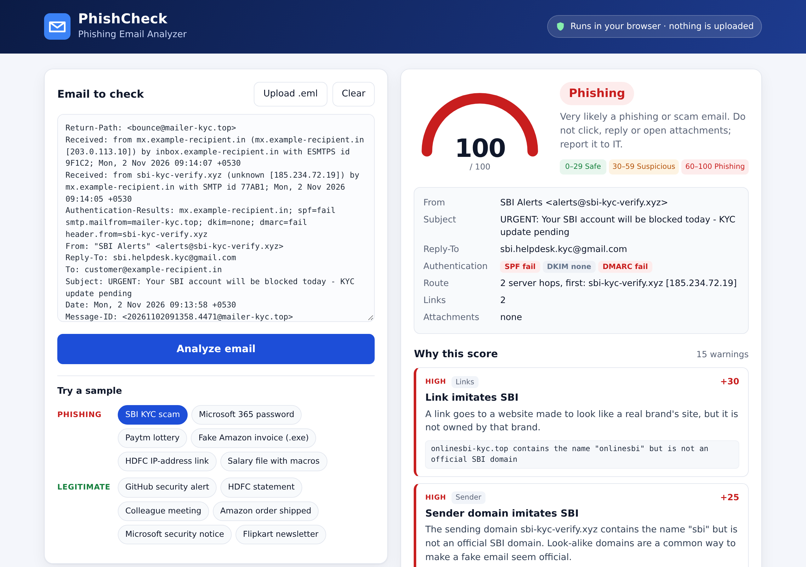

# PhishCheck – Phishing Email Analyzer

[](https://nived-phishcheck.sites.tab.bot/)


[](LICENSE)

Paste a raw email or give it a `.eml` file and PhishCheck returns a **risk score from 0 to 100**, a verdict
(**Safe / Suspicious / Phishing**) and a list of findings, each explained in plain English so that
non-technical staff can understand *why* an email is dangerous.

It comes in two forms that share the same rules:

- **Python package + CLI** for IT/helpdesk use: `phishcheck analyze email.eml`, with JSON output for scripts.
- **Browser demo** – a single static page. Everything runs in JavaScript on the page; the email never leaves your computer.

**Live demo:** https://nived-phishcheck.sites.tab.bot/



## Why I built this

In IT support, the most common security question from staff is "Is this email genuine?". Fake KYC
updates, "your account will be blocked" messages, lottery wins and invoices with odd attachments arrive
every week. PhishCheck automates the checks I do by hand (sender, authentication results, where links
really go, the wording and the attachments) and explains the result in words a store or office colleague
can follow.

## Features

| Area | What is checked |
|---|---|
| **Sender / headers** | Reply-To or Return-Path on a different domain · display name that shows a fake email address · brand name in the display name (SBI, HDFC, Paytm, Amazon, Microsoft…) sent from an unrelated or free-mail domain · look-alike sender domains · SPF / DKIM / DMARC results from `Authentication-Results` (only the top-most, receiver-added header is trusted) · Message-ID domain · `Received` hops (route and originating server) |
| **Links** | Visible link text that shows one address but opens another · IP-address URLs (including decimal/hex forms) · URL shorteners · punycode / Unicode homoglyph domains (`xn--`, Cyrillic look-alikes) · typosquatted and look-alike brand domains (`rnicrosoft`, `amaz0n`, `onlinesbi-kyc.top`) · suspicious TLDs (`.xyz`, `.top`, `.cyou`…) · `@` in the URL · long sub-domain chains · plain `http` |
| **Wording** | Urgency and threats · requests for passwords, OTP, PIN, CVV · common Indian scam phrases (KYC update, account blocked, PAN/Aadhaar, tax refund, electricity disconnection, KBC) · lottery/prize lures · "Enable Content" instructions · generic greetings ("Dear Customer") |
| **Attachments** | Executable and script types (`.exe`, `.js`, `.vbs`, `.iso`, `.lnk`, `.ps1`…) · double extensions (`invoice.pdf.exe`) · macro-enabled Office files (`.docm`, `.xlsm`) and legacy `.doc/.xls` containing a VBA project · HTML attachments (fake login pages) · archives |
| **Optional** | VirusTotal lookup of attachment hashes and links, only when you pass `--virustotal` **and** set `VT_API_KEY`. Off by default; files are never uploaded, only hashes/URL ids are looked up. |

## Quick start

```bash
git clone https://github.com/connectnived-lab/phishing-email-analyzer.git
cd phishing-email-analyzer
python -m venv .venv
source .venv/bin/activate        # Windows: .venv\Scripts\activate
pip install -e ".[dev]"

phishcheck analyze samples/phishing/01_sbi_kyc_update.eml
phishcheck analyze --json samples/legit/02_hdfc_statement.eml
phishcheck analyze samples/*/*.eml          # several files at once
cat message.eml | phishcheck analyze -      # read from stdin
```

No third-party packages are needed at runtime (standard library only). `pytest` is the only dev dependency.

**Exit codes:** `0` Safe, `1` Suspicious, `2` Phishing, `3` file could not be read. Useful in scripts,
for example to triage a folder of reported emails.

**Getting the raw email:** in Gmail open the message → ⋮ → *Show original* → *Download original* (`.eml`).
In Outlook on the web or the new Outlook: ⋯ → *Save as* / *Download* (`.eml`). In classic Outlook: open the
message → *File → Properties*, copy the *Internet headers* and paste them followed by the message text.
Pasting only the body works too, but the header checks are then skipped.

### Web demo locally

```bash
cd web
python -m http.server 8000      # then open http://localhost:8000
```

## Example output

```text
$ phishcheck analyze samples/phishing/03_paytm_lottery.eml
  Verdict : PHISHING   (risk score 60/100)
  Subject : Congratulations! You have won Rs 25,00,000 in Paytm Lucky Draw
  From    : Paytm Lucky Draw <paytm.rewards.dept@yahoo.com>
  Auth    : SPF=pass  DKIM=pass  DMARC=pass
  Route   : 1 hop(s), first server sonic.mail.yahoo.example [74.6.0.1]
  Links   : 1    Attachments: none

  [MEDIUM] +20  Promises a prize or reward
                 The email says you have won something or offers money or gifts. Unexpected
                 prizes are a classic lure, often followed by a request for a "processing
                 fee" or your bank details.
                 > "you have won"
                 > "congratulations you"
                 > "winner"

  [MEDIUM] +15  "Paytm" email sent from a free personal account
                 The sender calls itself Paytm, but the email came from a free yahoo.com
                 account. Banks and large companies never contact customers from Gmail,
                 Yahoo or similar accounts.
                 > From: Paytm Lucky Draw <paytm.rewards.dept@yahoo.com>

  [MEDIUM] +10  Shortened link hides the destination
                 A link uses a URL shortener, so you cannot see where it really leads until
                 you click.
                 > https://bit.ly/paytm-prize-claim26

  [MEDIUM] +10  Pressure to act quickly
                 The email tries to rush you with deadlines or threats (account closure,
                 legal action). Scammers create panic so you act before you think.
                 > "today only"

  [LOW   ] +5   Generic greeting instead of your name
                 The email starts with "Dear Customer" or similar. Companies you have an
                 account with usually address you by name.
                 > "dear winner"
```

JSON output (`--json`), shortened to the first 3 of 8 findings:

```json
{
  "file": "samples/phishing/04_amazon_invoice_attachment.eml",
  "score": 100,
  "verdict": "Phishing",
  "summary": {
    "from": "Amazon.in <order-update@amazon.in>",
    "authentication": {
      "spf": "pass",
      "dkim": "none",
      "dmarc": "fail"
    },
    "attachments": [
      "Amazon_Invoice_8812730.pdf.exe"
    ]
  },
  "findings": [
    {
      "rule_id": "A_DANGEROUS_EXT",
      "category": "attachments",
      "title": "Attachment can run programs on your computer",
      "points": 40,
      "severity": "high",
      "evidence": [
        "Amazon_Invoice_8812730.pdf.exe"
      ]
    },
    {
      "rule_id": "A_DOUBLE_EXT",
      "category": "attachments",
      "title": "Attachment has a disguised file type",
      "points": 30,
      "severity": "high",
      "evidence": [
        "Amazon_Invoice_8812730.pdf.exe"
      ]
    },
    {
      "rule_id": "H_DMARC_FAIL",
      "category": "headers",
      "title": "DMARC check failed",
      "points": 20,
      "severity": "medium",
      "evidence": [
        "dmarc=fail"
      ]
    }
  ]
}
```

## How scoring works

Every check that fires adds a fixed number of points. The total is capped at 100.

| Score | Verdict | Meaning |
|---|---|---|
| 0–29 | **Safe** | No strong warning signs |
| 30–59 | **Suspicious** | Several warning signs; verify the sender another way before acting |
| 60–100 | **Phishing** | Very likely phishing or a scam |

Main weights (every rule is listed in [docs/RULES.md](docs/RULES.md); values live in [`rules.json`](src/phishcheck/data/rules.json)):

| Finding | Points |
|---|---|
| Dangerous attachment type (`.exe`, `.js`, `.iso`…) | 40 |
| Link imitates a known brand / double extension | 30 |
| Link text hides the real destination · macro document · look-alike sender domain | 25 |
| DMARC fail · IP-address link · `@` in link · punycode domain · fake brand in sender name | 20 |
| SPF fail · DKIM fail · Reply-To mismatch · credential request · Indian scam wording · prize lure | 15 |
| Urgency · URL shortener · suspicious TLD · long sub-domain chain | 10 |
| Generic greeting · plain http link · no authentication results · Message-ID mismatch | 5 |

A wording category gets +5 extra when three or more different phrases from it appear. A Return-Path
mismatch (8) and a Message-ID mismatch are ignored when DMARC passes, because legitimate bulk senders
(GitHub, Amazon, newsletters) often use separate bounce domains.

Points are additive on purpose: a single weak signal (a shortened link in a newsletter) stays Safe, while
several independent signals push an email over the line. The six legitimate samples score 0–20 and the six
phishing samples score 60–100.

## Project layout

```text
src/phishcheck/
  parser.py           raw email → headers, bodies, links, attachments (stdlib email module)
  domains.py          hostname, registered domain, punycode, confusable characters, look-alike detection
  checks/headers.py   sender, Reply-To / Return-Path, SPF/DKIM/DMARC, Message-ID
  checks/links.py     link checks
  checks/content.py   phrase lists
  checks/attachments.py
  analyzer.py         runs all checks, scores, parses Received hops
  report.py, cli.py   console and JSON output
  virustotal.py       optional, off by default
  data/rules.json     weights, brand list, phrase lists (shared with the web demo)
web/                  static demo: index.html, css/, js/analyzer.js (JavaScript port), js/app.js
samples/              6 phishing + 6 legitimate .eml files (fictional, safe to open)
tests/                pytest suite
scripts/build_web.py  copies rules.json and the samples into web/js/
scripts/web_analyze.js runs the JavaScript engine under Node (used by the parity test)
```

## Tests

```bash
pytest -q
```

The suite (90 tests) covers every rule with small crafted emails, checks that all six phishing samples
are flagged and all six legitimate samples are Safe, tests the CLI and JSON output, mocks the VirusTotal
API, and includes a **parity test** that runs the JavaScript engine under Node and asserts it produces the
same findings and score as the Python package for every sample (skipped if Node is not installed).

After editing `rules.json` or the samples, run `python scripts/build_web.py` to refresh the web demo.

## Limitations

- **Heuristics, not a verdict from your mail server.** A clean score does not prove an email is safe, and a
  well-crafted targeted email (a real compromised account, no links, no attachment) can score low.
- **Authentication results are read, not re-verified.** PhishCheck reads the SPF/DKIM/DMARC verdicts your
  mail server wrote into `Authentication-Results`; it does not do DNS lookups or verify DKIM signatures itself.
  Only the top-most header is trusted, since lower ones could be written by the sender.
- **Brand list is small and hand-maintained** (Indian banks and payment apps, Amazon, Microsoft, Google,
  Apple, PayPal and a few others). Look-alikes of brands not on the list are only caught by the generic
  link checks.
- **Registered-domain detection is simplified.** A short list of two-part suffixes (`co.in`, `gov.in`,
  `co.uk`…) is used instead of the full Public Suffix List, to keep zero dependencies.
- **English phrase lists.** Wording checks are English plus common Indian scam phrases written in English.
  Emails in Malayalam, Hindi or other scripts are only covered by the header, link and attachment checks.
- **No sandboxing.** Attachments are judged by name, type and a simple macro marker search; they are never
  opened or executed. Links are never visited.
- **Outlook `.msg` files** are not supported yet; save as `.eml` or paste the source.

## Roadmap

- [ ] `.msg` (Outlook) support
- [ ] Optional DNS checks: domain age (WHOIS/RDAP), MX/SPF records of the sender domain
- [ ] Full Public Suffix List as an optional dependency
- [ ] Malayalam and Hindi phrase lists
- [ ] Batch mode with CSV report for a folder of reported emails
- [ ] Outlook / Gmail add-in that sends the current message to the analyzer
- [ ] QR-code links inside image attachments ("quishing")

## Author

**Nived NS** – IT Support Executive, Kozhikode, Kerala
LinkedIn: [linkedin.com/in/your-profile](https://www.linkedin.com/in/your-profile)

## License

[MIT](LICENSE) © 2026 Nived NS

The sample emails are fictional and written for testing. Domains such as `example-recipient.in` and
`contoso-retail.in` are placeholders. Brand names belong to their owners and are used only to show how
impersonation is detected.
